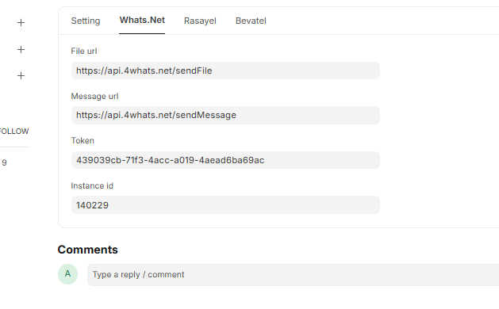
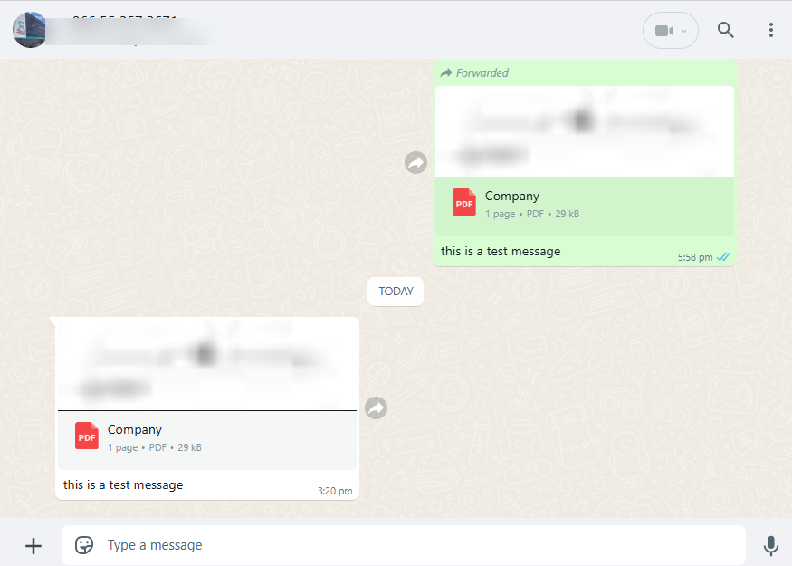
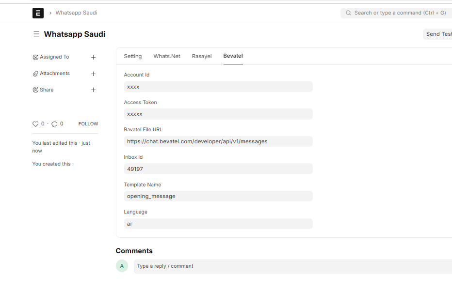
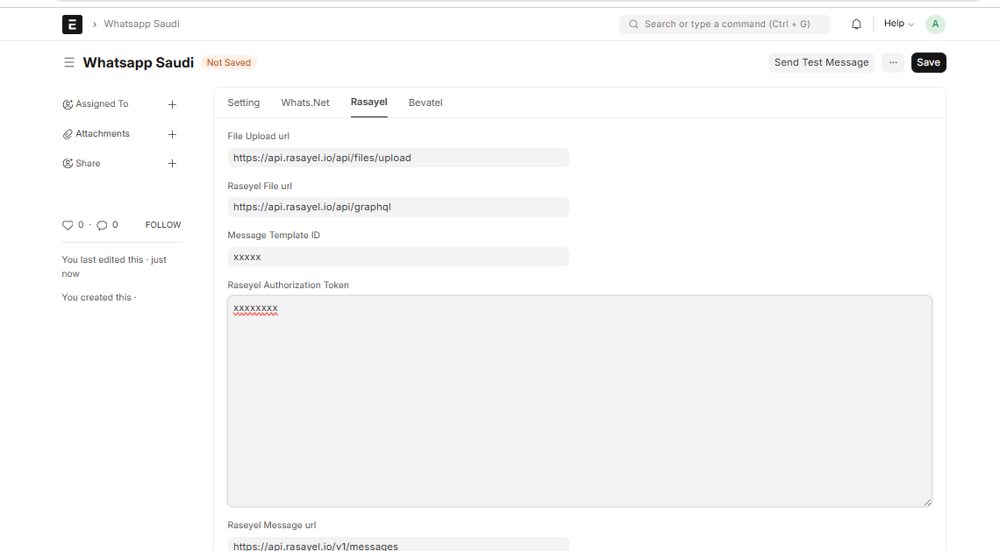
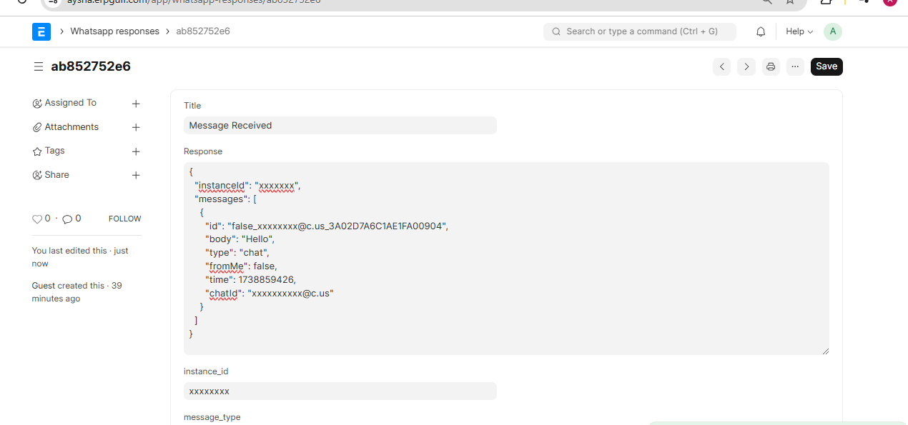

# WhatsApp Saudi

> Multi-provider WhatsApp, SMS (Corbit) & Firebase push notification integration for ERPNext / Frappe Framework.

[](./license.txt)
[](https://frappeframework.com)
[](https://erpnext.com)
[](https://erpgulf.com)

---

## Table of Contents

- [Overview](#overview)
- [Features](#features)
- [Prerequisites](#prerequisites)
- [Installation](#installation)
- [Configuration](#configuration)
  - [4Whats.net](#1-4whatsnet-global-provider)
  - [Bevatel](#2-bevatel)
  - [Rasayel](#3-rasayel)
  - [Firebase Notifications](#4-firebase-notifications)
  - [Corbit SMS](#5-corbit-sms)
- [Webhook Setup](#webhook-setup-for-incoming-messages)
- [Template Handling](#template-handling-system)
- [File & Document Sending](#file--document-sending)
- [IP Whitelisting (Geo-fencing)](#ip-whitelisting-for-geo-fencing)
- [API Reference](#api-reference)
- [Author](#author)

---

## Overview

**WhatsApp Saudi** integrates ERPNext with multiple WhatsApp business API providers, enabling automated notifications, document delivery, and incoming message handling — all from within ERPNext. It also supports **Firebase Cloud Messaging (FCM)** for push notifications to Android and iOS apps, and **Corbit SMS** ([corbit.sa](https://corbit.sa)) for SMS notifications and OTP.

The app overrides the standard Frappe `Notification` doctype to add **WhatsApp Saudi**, **Firebase Notification** and **Corbit SMS** channels alongside the built-in Email/SMS channels.

---

## Features

### v2.0 Highlights

| Feature | Description |
|---|---|
| Multi-provider support | Switch between 4Whats.net, Bevatel, and Rasayel from a single setting |
| Send PDFs & Documents | Attach Sales Invoice PDFs (standard or PDF/A-3) directly via WhatsApp |
| Firebase Push Notifications | Send to individual device tokens or broadcast to topics (Android + iOS) |
| Incoming message webhook | Incoming WhatsApp messages are stored in the **WhatsApp Response** doctype |
| Error logging | All API failures are captured in Frappe Error Log |
| Success logging | Successful sends are recorded in the **WhatsApp Saudi Success Log** doctype |
| Dynamic templates | Template variables are fetched from ERPNext documents at send time |
| Saudi phone normalisation | Local 05xxxxxxxx numbers are automatically converted to 9665xxxxxxxx |
| Corbit SMS channel | Send SMS through the Corbit gateway as a Notification channel, from Python, or via REST API |
| OTP via SMS | Optionally route `send_otp` through Corbit SMS instead of the WhatsApp provider |

---

## Prerequisites

- ERPNext **v15** (Frappe Framework v15)
- Python **>= 3.10**
- An active account with at least one supported provider (4Whats.net, Bevatel, or Rasayel)
- *(Optional)* A Firebase project with a service-account key for push notifications
- *(Optional)* A Corbit SMS account ([sms.corbit.sa](https://sms.corbit.sa)) with an API token and an approved sender name

---

## Installation

### 1. Get the app

```bash
bench get-app https://github.com/ERPGulf/whatsapp_saudi.git
bench get-app https://github.com/ERPGulf/whatsapp_saudi.git
```

### 2. Install on your site

### 2. Install on your site

```bash
bench --site your-site-name install-app whatsapp_saudi
```

### 3. Migrate and restart

### 3. Migrate and restart

```bash
bench --site your-site-name migrate
bench restart
```

---

## Configuration

All provider credentials are stored in a single **Whatsapp Saudi** singleton doctype:

```
ERPNext → WhatsApp Saudi → Whatsapp Saudi
```

---

### 1. 4Whats.net (Global Provider)



| Field | Description |
|---|---|
| Instance ID | Your 4Whats.net instance identifier |
| API Token | API token from your 4Whats.net dashboard |
| Message URL | REST endpoint for text messages |
| File URL | REST endpoint for file/PDF messages |
| Webhook URL | Receive incoming messages (see [Webhook Setup](#webhook-setup-for-incoming-messages)) |

**Supported:**
- Text messages
- PDF / file sending
- Incoming webhook handling

After filling in the credentials, click **Send Test Message** to verify connectivity.



---

### 2. Bevatel



| Field | Description |
|---|---|
| Account ID | API Account ID from your Bevatel profile |
| Access Token | API Access Token from your Bevatel profile |
| Inbox ID | The inbox to send messages through |
| Base API URL | Bevatel base API URL |
| Template Name | Default WhatsApp template name |
| Language | Default language code (e.g. `en`, `ar`) |

**Supported:**
- Template-based text messages
- Template-based PDF messages (PDF/A-3)

---

### 3. Rasayel



| Field | Description |
|---|---|
| Authorization Token | Bearer token from your Rasayel dashboard |
| Channel ID | Rasayel channel ID |
| Message Template ID | Default template ID for text messages |
| Rasayel Message API | GraphQL endpoint for text messages |
| Rasayel File API | GraphQL endpoint for file uploads and file messages |
| File Upload URL | REST endpoint for blob uploads |

**Supported:**
- Template-based text messages
- PDF and PDF/A-3 document sending
- Conversation auto-close after message delivery

---

### 4. Firebase Notifications

Firebase Cloud Messaging credentials are stored directly in the **Whatsapp Saudi** doctype. Enable the **Firebase Notification** toggle first, then fill in the service-account fields:

| Field | Description |
|---|---|
| Type | `service_account` |
| Project ID | Firebase project ID |
| Private Key ID | Private key ID from the JSON key file |
| Private Key | Private key (PEM) from the JSON key file |
| Client Email | Service account email |
| Client ID | Service account client ID |
| Auth URI / Token URI | Google OAuth endpoints |
| Auth Provider Cert URL | Google auth provider X.509 cert URL |
| Client Cert URL | Service account X.509 cert URL |

To send a notification through the Frappe **Notification** doctype, set the channel to **Firebase Notification** and structure the **Message** field as JSON:

```json
{
  "message": {
    "token": "{{ doc.custom_fcm_token }}",
    "notification": {
      "body": "Your invoice {{ doc.name }} has been generated."
    }
  }
}
```

Use `"topic"` instead of `"token"` to broadcast to all subscribed devices:

```json
{
  "message": {
    "topic": "announcements",
    "notification": {
      "title": "System Notice",
      "body": "Scheduled maintenance tonight at 11 PM."
    }
  }
}
```

> Firebase messages are dispatched via a background queue (`long`) and support both Android (high-priority) and iOS (APNS) configurations automatically.

---

### 5. Corbit SMS

Corbit SMS ([api.corbit.sa](https://api.corbit.sa)) works **alongside** the selected WhatsApp provider — it does not replace it. Settings are on the **Corbit SMS** tab of the **Whatsapp Saudi** doctype. All fields except *Enable* are hidden until it is ticked.

| Field | Description |
|---|---|
| Enable Corbit SMS | Master switch. While off, every send returns a `CONFIG` error |
| Base URL | `https://api.corbit.sa` — **server address only**. The app appends `/api/v1/send` itself, so do not include the path |
| API Token | Token from your Corbit account (sms.corbit.sa). Sent as `Authorization: Bearer`, stored encrypted |
| Sender Name | Must exactly match a sender name **approved** on your Corbit account, otherwise Corbit returns `422` (`اسم المرسل غير مسموح به` — "sender name not allowed") |
| Send OTP via Corbit SMS | When ticked, `send_otp` sends the OTP by SMS instead of WhatsApp |

After saving, click **Send Test SMS (Corbit)** (System Manager only). It sends to the **To Number (for testing)** field on the Setting tab and shows the Corbit message ID on success, or the error code on failure.

**Supported:**
- **Notification channel** — set Channel to **Corbit SMS** on any Notification. Recipients work the same as the WhatsApp Saudi channel (Phone fields, owner, role mobile numbers). The message is rendered with Jinja, HTML is stripped, and sending runs in the `long` background queue.
- **OTP** — `send_otp` routes through Corbit when *Send OTP via Corbit SMS* is ticked (duplicate check bypassed so resends work).
- **Python / REST API** — see examples below.

**From Python:**

```python
from whatsapp_saudi.overrides.corbit_sms import send_corbit_sms, send_corbit_sms_bulk

send_corbit_sms("0551234567", "Your invoice is ready")
send_corbit_sms(phone, otp_text, allow_duplicate=True)          # e.g. OTP resends
send_corbit_sms_bulk(["0551234567", "+966 55 000 1111"], "Reminder")
```

**From the REST API:**

```bash
curl -X POST "https://your-site/api/method/whatsapp_saudi.overrides.corbit_sms.send_sms" \
  -H "Authorization: token api_key:api_secret" \
  -H "Content-Type: application/json" \
  -d '{"phone": "0551234567", "message": "Hello"}'
```

Every call returns a dict:

```json
{ "success": true,  "status": "success", "phone": "966551234567", "message_id": "8493f201-…", "delivery_status": "pending" }
{ "success": false, "status": "error",   "phone": "966551234567", "code": "INSUFFICIENT_BALANCE", "http_status": 402, "error": "…" }
```

**How Corbit's rules are handled:**

| Rule | Behaviour |
|---|---|
| Phone numbers | Normalised (05… → 9665…), non-digits removed, must be 8–15 digits. Invalid numbers return `VALIDATION` and nothing is sent |
| Message length | Max 1600 characters; longer messages are truncated and the truncation is logged |
| Duplicate protection | Corbit rejects the same text to the same number within 1 hour (`409`). Notifications keep this protection; OTP and test sends bypass it with `X-Allow-Duplicate: true` |
| Rate limits / outages | On `429` / `502` / `503`, retried once if `Retry-After` is 10 seconds or less |
| Bulk | One `/send` call per number; numbers that are identical after normalising are sent once |
| Idempotency | Optional `idempotency_key` argument sets the `Idempotency-Key` header |

**Logging:** successful sends are recorded in **WhatsApp Saudi Success Log** (title *Corbit SMS sent*, with the Corbit message ID and status). Failures go to **Error Log** titled *Corbit SMS failed (CODE)* with the full Corbit response.

**Troubleshooting:**

| Error | Cause / fix |
|---|---|
| `404 Not found.` | Base URL contains `/api/v1/send`. Set it to `https://api.corbit.sa` only |
| `NETWORK` / name resolution error | Typo in Base URL (e.g. stray `.` or space) |
| `422` sender name not allowed | Sender name is not approved on the Corbit account. List approved names with `GET /api/v1/sendernames` |
| `402 INSUFFICIENT_BALANCE` | Top up the Corbit account |
| Sent (`pending`) but status later `failed` | Corbit accepted the request but it was not delivered — often an international (non-Saudi) number not enabled for the account. Contact Corbit support with the message ID |

Check delivery status of a message directly with Corbit:

```bash
curl -s -X POST "https://api.corbit.sa/api/v1/message-status/<message_id>" \
  -H "Authorization: Bearer <corbit_token>"
```

---

## Webhook Setup for Incoming Messages

In your **4Whats.net** dashboard, configure the webhook URL to:

```

In your **4Whats.net** dashboard, configure the webhook URL to:

```
https://your-erpnext-instance.com/api/method/whatsapp_saudi.receive_whatsapp_message
```

Replace `your-erpnext-instance.com` with your actual ERPNext domain.

All incoming messages will be automatically saved to the **WhatsApp Response** doctype in ERPNext.



---

## Template Handling System

WhatsApp Saudi supports dynamic variable substitution in notification templates.

### Variable-Based Templates

Define variables in the Notification **Message** field using `key="value"` pairs. Values support Jinja2 expressions:

```
message_template_id="123456"
var1="{{ doc.customer_name }}"
var2="{{ doc.name }}"
var3="{{ doc.grand_total }}"
language="en"
```

- Variables named `var1`, `var2`, … are automatically mapped to template body parameters in order.
- `message_template_id` selects the WhatsApp-approved template.
- `language` overrides the default language from the provider settings.

### Per-Provider Payload Format

The app automatically formats the payload for the active provider — no manual switching required.

---

## File & Document Sending

### From the Notification Doctype

Enable **Attach Print** and select a **Print Format** on any Notification configured with the **WhatsApp Saudi** channel. The app will generate the PDF and attach it to the outgoing message.

| Provider | Standard PDF | PDF/A-3 (ZATCA) |
|---|---|---|
| 4Whats.net | Supported | Supported |
| Rasayel | Supported | Supported |
| Bevatel | Supported | Supported |

### From the Sales Invoice Form

A **Send via WhatsApp** button is available directly on the Sales Invoice form. It reads the customer's `custom_whatsapp_number_` field and dispatches the active provider's PDF or PDF/A-3 flow.

---

## IP Whitelisting for Geo-fencing

If your server uses IP or country-based geo-fencing, you must whitelist the Meta / WhatsApp infrastructure IPs. As of the last update these are:

```
173.252.64.0/18
31.13.24.0/21
31.13.64.0/18
66.220.144.0/20
69.63.176.0/20
129.134.0.0/16
```

> These ranges may change. Monitor your Nginx or Apache access logs and update the allowlist accordingly if messages stop arriving.

---

## API Reference

All endpoints below are Frappe whitelisted methods callable via:
```
POST /api/method/<method_path>
```

| Method | Description |
|---|---|
| `whatsapp_saudi.overrides.whtatsapp_notification.send_whatsapp_text` | Send a plain-text WhatsApp message via 4Whats.net |
| `whatsapp_saudi.overrides.whtatsapp_notification.send_whatsapp_with_pdf1` | Send a PDF (standard) via 4Whats.net from a Sales Invoice |
| `whatsapp_saudi.overrides.whtatsapp_notification.get_whatsapp_pdf` | Provider-aware: send standard PDF (auto-routes to active provider) |
| `whatsapp_saudi.overrides.whtatsapp_notification.get_whatsapp_pdf_a3` | Provider-aware: send PDF/A-3 (auto-routes to active provider) |
| `whatsapp_saudi.overrides.whtatsapp_notification.rasayel_whatsapp_message1` | Send a Rasayel template text message directly by phone number |
| `whatsapp_saudi.overrides.whtatsapp_notification.rasayel_whatsapp_file_message_pdf` | Upload and send a standard PDF via Rasayel |
| `whatsapp_saudi.overrides.whtatsapp_notification.rasayel_whatsapp_file_message_pdfa3` | Upload and send a PDF/A-3 via Rasayel |
| `whatsapp_saudi.overrides.whtatsapp_notification.send_bevatel_file_template_message_pdf` | Send a standard PDF via Bevatel template |
| `whatsapp_saudi.overrides.whtatsapp_notification.send_bevatel_file_template_message_pdf_a3` | Send a PDF/A-3 via Bevatel template |
| `whatsapp_saudi.overrides.whtatsapp_notification.send_firebase_notification` | Send a Firebase push notification by token or topic |
| `whatsapp_saudi.overrides.whtatsapp_notification.test_firebase_push` | Test Firebase connectivity (guest-allowed) |
| `whatsapp_saudi.overrides.whtatsapp_notification.send_otp` | Send an OTP — via Corbit SMS if *Send OTP via Corbit SMS* is ticked, otherwise via the active WhatsApp provider |
| `whatsapp_saudi.overrides.corbit_sms.send_sms` | Send a plain SMS via Corbit (`phone`, `message`) |
| `whatsapp_saudi.overrides.corbit_sms.test_corbit_sms` | Send a test SMS to *To Number (for testing)* (System Manager only) |

---

## Author

**Aysha Sithara**
Published by [ERPGulf.com](https://erpgulf.com) — support@ERPGulf.com

---

###### License

MIT — see [license.txt](./license.txt)
